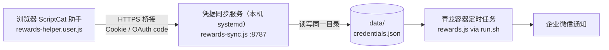

# Microsoft Rewards 青龙全功能版

把脚本猫 [3947](https://scriptcat.org/zh-CN/script-show-page/3947) / [3956](https://scriptcat.org/zh-CN/script-show-page/3956) 改造成青龙面板可运行的无人值守方案：PC/手机搜索、网页每日活动、App 签到与阅读、热词、Cookie 自动同步、OAuth 授权与刷新令牌轮换，全部在服务端完成。

> **一句话前提**：你只需要在浏览器里本人登录一次 Bing 并完成一次微软 App 授权（不采集账号密码），之后 Cookie 自动同步、令牌自动刷新，青龙定时跑任务即可。单账号使用，浏览器和青龙不必在同一台设备。

## 功能

- **PC + 手机搜索**：UA 模拟，多来源热词容错（nntool → baiwumm → cnxiaobai → eray/zhusun/imsyy → 36 条内置词），可自定义词库
- **网页每日/更多活动**：使用新版 `/earn` 页面配套的 server action 活动凭证提交（不混用旧接口凭证）
- **App 签到 + 阅读活动**：独立 OAuth 授权，访问令牌按需刷新
- **Cookie 自动同步**：浏览器助手检测到 Cookie 变化时同步，未变化也每小时强制重传
- **凭据安全**：专用同步密钥 + Bearer 鉴权 + 仅放行 `.bing.com` 域；凭据文件 600，目录 700
- **稳定性**：401 刷新重试、瞬时 5xx 重试、跨进程文件锁、单任务失败不拖垮整轮
- **通知**：企业微信应用通知（失败 / 登录或授权失效当天一次 / 当日首次全部完成）

## 工作方式



关键点：**青龙本身是 Docker 容器，但同步服务不是**——它在本机以 systemd 常驻进程运行，两者只需访问同一个凭据目录（青龙通过挂载，宿主进程直接读写）。`run.sh` 会等到 Cookie 和 App 凭据都齐备后才发起任务。

## 目录结构

仓库根目录为青龙脚本根，`microsoft-rewards/` 是实际脚本目录：

```
qinglong-scripts/
├── README.md
├── .gitignore
└── microsoft-rewards/
    ├── rewards.js              # 青龙任务入口
    ├── rewards-common.js       # HTTP / Cookie / OAuth / 持久化 / 进程锁
    ├── rewards-sync.js         # 常驻凭据同步服务
    ├── rewards-helper.user.js  # 浏览器 ScriptCat 助手（公开版，无密钥）
    ├── rewards.test.js         # 离线回归测试，不碰真实账号
    ├── run.sh                  # 青龙定时任务入口
    ├── compose.yaml            # 可选：独立同步服务 Docker 模板
    ├── 使用说明.txt            # 完整参数与边界说明
    └── LICENSE                 # GPL-3.0
```

## 部署

### 环境要求

| 位置 | 要求 |
|---|---|
| 服务端 / 青龙 | Node.js **22+**（已在青龙 2.23.0 / Node 24 实测），无需 npm 包或浏览器 |
| 浏览器 | ScriptCat，支持 `GM_cookie`、`GM.setValue`，需授予 Cookie 读取与目标域名连接权限 |
| 网络 | 同步服务对浏览器可达；公网需 HTTPS 反向代理，或可信内网 HTTP |

### 1. 启动凭据同步服务（systemd 常驻）

同步服务是一个常驻进程，**不是定时任务、也不在 Docker 里**。本机已有 systemd 服务 `rewards-sync.service`，如下是等价的配置方法。

先准备一个专用同步密钥（不是微软密码，也不是青龙密钥），并妥善保存——助手配置要用：

```bash
openssl rand -hex 32
```

写一份权限 600 的环境文件（例如 `<部署目录>/rewards-sync.env`）：

```ini
REWARDS_SYNC_KEY=<上一步生成的密钥>
REWARDS_DATA_DIR=<凭据目录绝对路径，例如 <部署根>/rewards-data>
REWARDS_SYNC_HOST=127.0.0.1
REWARDS_SYNC_PORT=8787
```

建立 `/etc/systemd/system/rewards-sync.service`：

```ini
[Unit]
Description=Microsoft Rewards credential sync bridge
After=network-online.target

[Service]
Type=simple
EnvironmentFile=<部署目录>/rewards-sync.env
ExecStart=/usr/bin/node <脚本绝对路径>/rewards-sync.js
Restart=unless-stopped

[Install]
WantedBy=multi-user.target
```

启动并设置开机自启：

```bash
systemctl daemon-reload && systemctl enable --now rewards-sync
```

服务只监听 `127.0.0.1:8787`。用现有 HTTPS 反向代理把一个你控制的**独立子域名根路径**转发过来（按你自己的域名配置）——助手不接受带子路径的桥接地址，服务自身也不做 TLS。若要在可信内网用 HTTP，需额外设 `REWARDS_ALLOW_HTTP=1`，且不要把 8787 明文暴露公网。

> **附：可选 Docker 模板**
> 仓库里的 `compose.yaml` 只是一份等价的容器化模板，`docker compose up -d` 同样能跑起同步服务，默认也只发布到 `127.0.0.1:8787`。本机实际部署**没有用它**，保留仅作为其他环境的备选。用 Docker 时凭据落在同目录的 `data/`，青龙仍需挂载这同一个底层目录。

### 2. 青龙侧配置

1. 把 `run.sh`、`rewards.js`、`rewards-common.js` 复制到青龙脚本的**同一个子目录**。
2. 把同步服务目录的 `data/` 以**可读写**方式挂载进青龙容器，例如 `/ql/data/rewards-data`。
3. 青龙环境变量添加：

   ```bash
   REWARDS_DATA_DIR=/ql/data/rewards-data
   ```

   青龙容器和本机同步进程必须指向同一个底层目录（青龙靠挂载、宿主进程直接读写）。若两端 UID 不同，需对齐运行 UID / 目录权限（凭据文件 600、目录 700，不要图省事放宽到 777）。

4. 青龙新建**普通定时任务**，命令为：

   ```bash
   task <你的脚本子目录>/run.sh
   ```

   定时表达式（5 段，青龙 2.23.0 实测可用）：

   ```cron
   7,27,47 * * * *
   ```

   若你的青龙调度器要求 6 段（含秒），用 `0 7,27,47 * * * *`。**不要**给 `rewards-sync.js` 设定时启动，它是常驻服务。

### 3. 浏览器一次性设置

1. 安装 `rewards-helper.user.js` 到 ScriptCat；**关闭原 3947 / 3956**（原助手会清除 OAuth 回调参数），登录 Rewards 账号。
2. 在 Bing 或 Rewards 页面打开助手菜单，配置：
   - **配置桥接 URL 和专用同步密钥** → 填 `https://你的桥接域名` 或可信内网 `http://IP:8787`，密钥填服务端的 `REWARDS_SYNC_KEY`
   - **立即同步 Bing Cookie**
   - **首次 / 重新授权 Rewards App** → 在微软页面用**同一账号**登录并同意授权
   - 回调同步失败时，保持回调页打开，用 **重试本页 App 授权同步**；刷新页面或超过 10 分钟需重新发起授权
3. 授予 Cookie 和目标域名连接权限。

助手在匹配的标签页加载时及每 15 分钟检查一次 Cookie 变化；关闭所有匹配标签页后不再采集，建议保留一个页面。浏览器关闭后青龙仍可用已同步的 Cookie，但无法从关闭的浏览器读取新 Cookie。App 访问令牌由服务端自行刷新，不需要浏览器常开。

### 4. 验证

先在青龙实际运行环境做一次不提交任务的检查：

```bash
node /你的脚本路径/rewards.js --check
```

预期看到“网页会话有效”和“App 令牌和查询接口有效”。然后手动跑一次正常任务，确认积分到账，再开启定时。

> `GET /health` 只说明同步服务在线，**不代表**微软登录仍有效。

## 环境变量

青龙任务可选配置（布尔项用 `1` / `0`）：

| 变量 | 默认 | 说明 |
|---|---|---|
| `REWARDS_APP` | `1` | 设 `0` 关闭 App 签到和阅读 |
| `REWARDS_READ` | `1` | 设 `0` 仅关闭阅读 |
| `REWARDS_PROMO` | `1` | 设 `0` 关闭网页每日/更多活动 |
| `REWARDS_SEARCH` | `1` | 设 `0` 关闭 PC 及手机搜索 |
| `REWARDS_SEARCH_LIMIT` | `6` | 本轮总搜索请求数，1~200 |
| `REWARDS_SEARCH_INTERVAL` | `15` | 搜索间隔秒数，随机 ±5 秒，10~300 |
| `REWARDS_HOT_WORDS` | `1` | 设 `0` 使用内置词库 |
| `REWARDS_HOT_URL` | — | 自定义热词接口完整 URL（HTTPS JSON，`code=200` 且 `data` 数组有 `title`） |
| `REWARDS_KEYWORDS` | — | 自定义搜索词，以 `\|` 分隔，优先级高于热词 |
| `REWARDS_MOBILE_UA` | — | 覆盖手机 User-Agent |
| `REWARDS_PUSH_URL` | — | 可选 HTTPS 成功心跳 URL，全部任务 done 时 GET |
| `REWARDS_NOTIFY` | run.sh 为 `1` | 直接 node 运行默认 `0`；启用走企业微信应用通知 |
| `REWARDS_QYWX_AM` | — | 任务专用企业微信配置；未设置时读 `QYWX_AM` |
| `QYWX_AM` | — | `企业ID,应用Secret,接收用户,agentid`，接收用户通常 `@all`；只写在青龙配置里，勿提交 |
| `REWARDS_REFRESH_TOKEN` | — | 首次手动导入旧 Refresh Token；已有持久化令牌时优先用持久化值 |

同步服务侧：`REWARDS_SYNC_KEY`（必填，至少 32 字符）、`REWARDS_DATA_DIR`、`REWARDS_SYNC_HOST`、`REWARDS_SYNC_PORT`、`REWARDS_ALLOW_HTTP`。注意青龙的环境变量**不会**自动进入独立的同步进程，两边要分别配置。

**通知策略**：一般任务失败会通知；网页登录 / App 授权失效当日同类告警只发一次；当日首次“全部完成”通知一次并持久去重（发送失败不标记成功）；`pending` 不触发普通通知。只达到搜索次数上限、连续 3 次不加分、活动仍未完成时如实报告 `pending`。阅读与网页活动无固定时间门槛，每轮按接口实际进度执行。

## 数据与恢复

| 文件 | 内容 |
|---|---|
| `credentials.json` | Cookie 域/path、UA、App Token、授权会话标识（600，**切勿分享**） |
| `state.json` | 当日接口确认状态、词库索引、完成通知去重标记 |
| `last-result.json` | 最近一次任务摘要，不含 Cookie / Token 正文 |
| `*.lock` | 进程互斥锁，正常退出或任务异常会自动释放 |

非正常结束（`kill -9`、宿主或容器断电）可能残留锁文件。本版**不会**自动抢删旧锁（避免跨进程覆盖令牌）：先停同步服务并确认没有任务在跑，备份数据后手工清理**确定残留的单个** `.lock` 文件再启动。不要在任务运行中清锁，也不要清空整个凭据目录（会丢授权）。换账号时先暂停任务，用新账号重新同步 Cookie 并重新 App 授权——一个数据目录对应一个账号。

## 已知限制

- 单账号；浏览器 Bing 登录与 App 授权必须使用同一账号，程序不自动核验两端身份。
- 不模拟测验答题，也不真正打开文章；交互型活动可能仍需人工。
- 不规避验证码或风控；异地出口、自动搜索与活动上报可能被微软限制。
- 接口和账号策略变化时可能无法完成；请求成功不代表积分一定到账。
- 沿用原脚本的 App 客户端 ID 和 offer，是否继续支持以真实账号接口响应为准。

## 测试

```bash
cd microsoft-rewards
node --test rewards.test.js
```

14 组离线测试覆盖 Cookie 隔离、状态校验、重定向与 UTF-8、本地同步鉴权、并发持久化与锁、搜索进度、签到校验、活动确认、401 刷新、任务隔离、多热词接口切换、新版页面凭证、503 重试、完成通知去重等，全部使用虚构凭据，不触碰真实账号。

## 来源与许可

- 协议参考：[ScriptCat #3947 v3.0.6](https://scriptcat.org/zh-CN/script-show-page/3947)（geoi6sam1 & Soul233）、[ScriptCat #3956 v0.3.0](https://scriptcat.org/zh-CN/script-show-page/3956)（Soul233）
- ScriptCat API 文档：https://docs.scriptcat.org/docs/dev/api/
- 本仓库为修改实现，保留上游协议与作者来源，按 [GNU GPL-3.0](microsoft-rewards/LICENSE) 发布。
- 代码按现状提供，不保证可用性、积分收益或账号状态。
